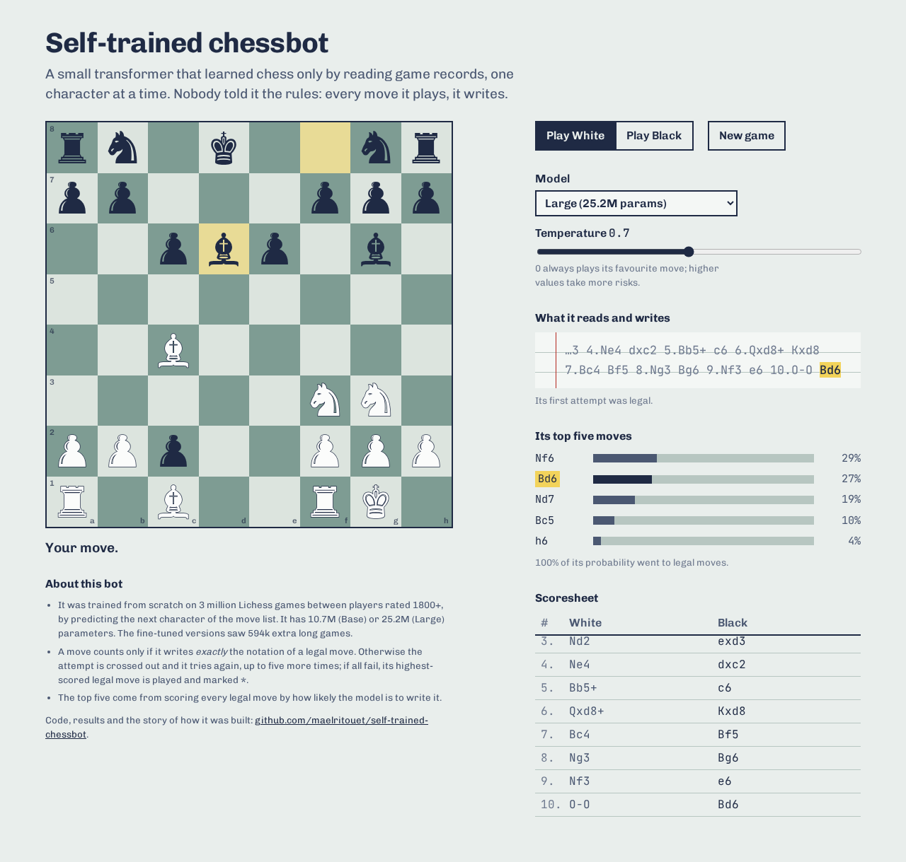
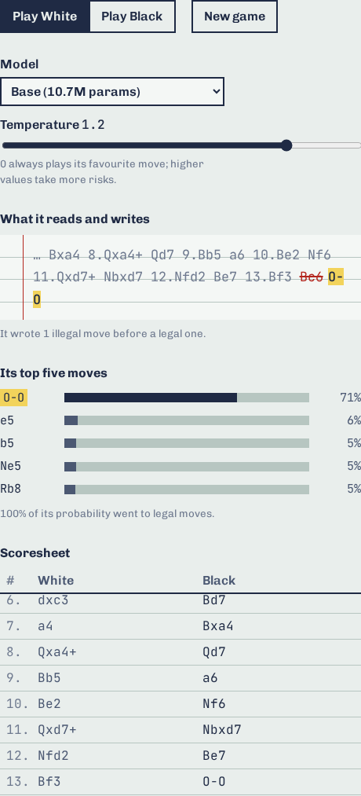
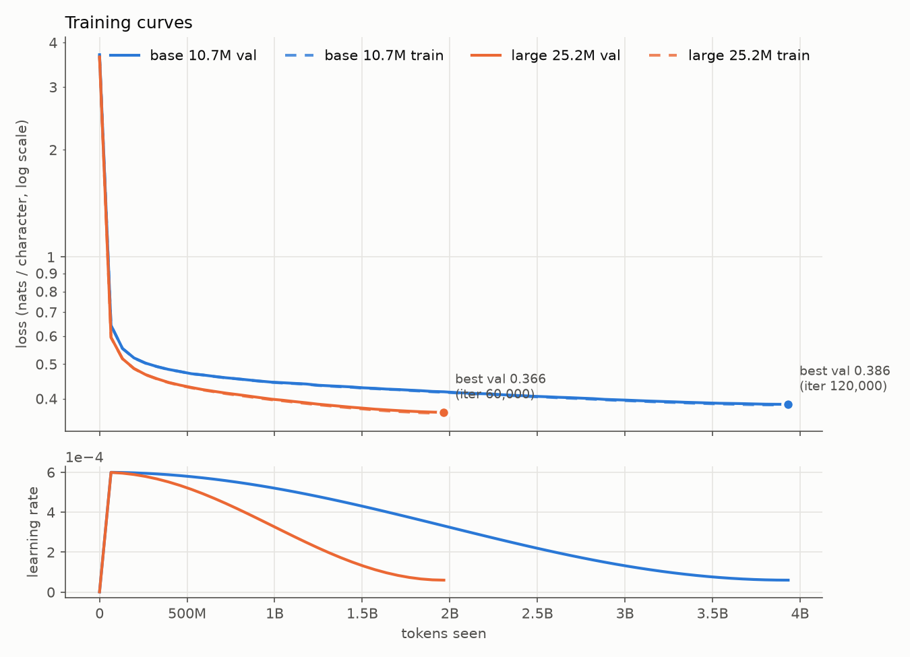
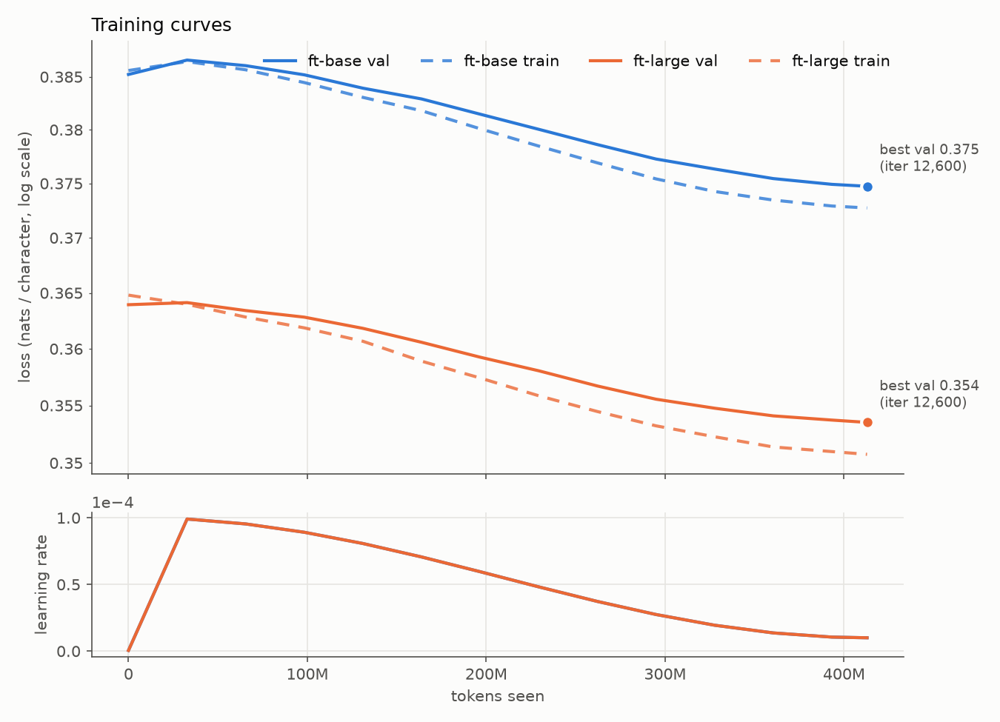

# self-trained-chessbot

A small GPT (10.7M and 25.2M parameters) trained **from scratch** on 3 million Lichess games. It is never told the rules of chess: it only learns to predict the next character of a game's move list (`1-0 1.e4 e5 2.Nf3 Nc6 …`). [python-chess](https://python-chess.readthedocs.io/) acts as the referee. You can play it in your browser, where it writes its moves one character at a time.

<p align="center"></p>

**In short:** the larger model plays a legal move on its first try 97.7% of the time, solves 11% of a set of Lichess puzzles (26% of those rated under 1000), and scores 0.17 against Stockfish's weakest setting. All of it came from reading game records; no chess rules, no search.

## Play it

The page runs the model in your browser (ONNX Runtime Web); nothing is sent anywhere. You need Python 3 and git.

```bash
git clone https://github.com/maelritouet/self-trained-chessbot.git
cd self-trained-chessbot
python3 scripts/fetch_models.py               # the 4 models, ~320 MB (or: --only base, 49 MB)
cd web && python3 -m http.server 8765         # then open http://localhost:8765/
```

The models come from the [v1.0 release](https://github.com/maelritouet/self-trained-chessbot/releases/tag/v1.0) and are checked against SHA-256 sums ([decision 013](docs/decisions/013-local-demo-models-in-release.md)). In the page:
- **Model** picks one of the four: Large (default), Base, and each fine-tuned on long games.
- **Temperature** 0 always plays the model's favourite move; higher values take more risks.
- **What it reads and writes** shows the text it sees and the move it is typing. If it writes something that isn't exactly a legal move, the attempt is crossed out in red and it tries again (up to 5 more times; then its best-scored legal move is played, marked `*`).
- **Its top five moves** scores every legal move by how likely the model is to write it.

<p align="center"><br><sub>Base model at temperature 1.2: it tried <code>Bc6</code> with a bishop traded off two moves earlier, then castled.</sub></p>

## How it works

- **Data.** Rated blitz, rapid and classical games where both players are rated 1800+, streamed from the [Lichess database](https://database.lichess.org) (October 2026) and rewritten as one line per game: `1-0 1.e4 e5 2.Nf3 …`. 3M games, 1.26B characters. The result comes first, so at play time the model is asked to play like the side that won.
- **Tokens.** One token per character: 33 symbols (SAN letters, digits, `+#=-/.`, space, and a newline between games).
- **Model.** GPT-2-style decoder with a 1,024-character context, in two sizes: **base** (6 layers, 6 heads, 384-dim, 10.7M parameters) and **large** (8 layers, 8 heads, 512-dim, 25.2M parameters).
- **Training.** On Kaggle (one T4 GPU, fp16 mixed precision, ~100k tokens/s for base), driven from a laptop with the Kaggle CLI. One ~9 h session per model.
- **Playing.** The model writes characters until a space. The text counts as a move only if it is **exactly** the SAN of a legal move ([decision 008](docs/decisions/008-legal-means-exact-san.md)): python-chess and chess.js would both accept `Nxf3` for `Nf3`, or `--` as a null move.

## Results

Four models: **base** and **large** trained from scratch on the same 3M games, and each one fine-tuned on long games (**ft-base**, **ft-large**). All numbers are measured on data the models never trained on.

| | base | large | ft-base | ft-large |
|---|---|---|---|---|
| Parameters | 10.7M | 25.2M | 10.7M | 25.2M |
| Training (one T4) | 3.93B tokens, 8.6 h | 1.97B tokens, 9.1 h | +413M tokens, 56 min | +413M tokens, 1.85 h |
| Val loss (nats/char) | 0.386 | 0.366 | 0.393 | 0.374 |
| Legal-move rate | 95.6% | 97.7% | 96.1% | **97.8%** |
| Same move as the human | 40.7% | 44.2% | 41.6% | **44.4%** |
| Puzzles solved (1,000) | 8.0% | **11.3%** | 6.8% | 8.3% |
| Score vs Stockfish Skill 0 / 1 / 2 | 0.06 / 0.00 / 0.03 | **0.17** / 0.02 / 0.00 | 0.09 / 0.02 / 0.01 | 0.08 / **0.06 / 0.02** |
| Forfeits vs Stockfish (of 150 games) | 49 | 39 | 52 | **28** |

**Legal-move rate by move number** (greedy first try, 100 held-out games, 8,197 positions):

| Moves | 1–10 | 11–20 | 21–30 | 31–40 | 41–50 | 51–60 | 61–70 | 71–80 | 81–90 |
|---|---|---|---|---|---|---|---|---|---|
| base | 99.8 | 97.0 | 94.9 | 92.2 | 91.3 | 93.8 | 95.5 | 89.1 | 85.0 |
| large | 99.9 | 99.0 | 96.2 | 96.1 | 95.5 | 97.1 | 97.0 | 97.0 | 95.0 |
| ft-base | 99.8 | 97.2 | 94.7 | 93.2 | 91.7 | 97.9 | 96.5 | 90.1 | 87.5 |
| ft-large | 99.9 | 98.7 | 96.8 | 96.1 | 96.1 | 97.4 | 97.5 | 96.0 | 92.5 |

**Puzzles by rating** (% solved, 200 Lichess puzzles per bucket):

| Rating | <1000 | 1000–1499 | 1500–1999 | 2000–2499 | 2500+ |
|---|---|---|---|---|---|
| base | 19.0 | 10.5 | 5.0 | 3.0 | 2.5 |
| large | 26.0 | 16.0 | 8.0 | 5.0 | 1.5 |
| ft-base | 13.0 | 9.5 | 6.5 | 4.0 | 1.0 |
| ft-large | 15.5 | 11.5 | 6.5 | 4.0 | 4.0 |

**Training curves.** Left: base vs large from scratch (train ≈ val: no overfitting). Right: the fine-tunes, with val loss on the long-game val set.

<p>
  
  
</p>

How these were measured:
- **Legal move** = the model's text is exactly the SAN of a legal move ([decision 008](docs/decisions/008-legal-means-exact-san.md)). "Same move as the human" is on the same positions.
- **Stockfish** = Stockfish 19 at UCI Skill Level 0, 1 and 2, 50,000 nodes per move, 50 games per level with alternating colours ([decision 011](docs/decisions/011-stockfish-levels.md)). Score = (wins + ½ draws) / games. The model gets 6 tries per move (greedy, then 5 sampled); after 6 illegal outputs it **forfeits** the game. With only 50 games per level, score differences of a few hundredths are noise.
- **Val loss** is on the original validation set (games from the same month as training).

What the results say:
- **Model size ([experiment 009](docs/decisions/009-experiment-model-size.md)).** Given the same compute (one ~9 h session), the 25.2M model beats the 10.7M one on every metric even though it saw half as many tokens: 47% fewer illegal outputs, puzzles 8.0 → 11.3%, and it holds its legality late in the game (95% at moves 81–90 vs 85%). Neither model overfit (train ≈ val loss throughout).
- **Fine-tuning on long games ([decision 012](docs/decisions/012-finetune-long-games.md)).** One pass over 594k games of 100+ plies from another month, aimed at the late-game legality drop. It is a trade-off. Both models forgot a little (val loss +0.008) and solved fewer puzzles. Only the large one gained in games: forfeits fell from 39 to 28 and it has the best overall legal-move rate. Late-game legality itself did not measurably change (positions past move 70 are too few in 100 games to tell). The small one gained nothing (49 → 52 forfeits). Likely reasons: long games are more often drawn (16.9% vs 5.8%), so they hold fewer decisive tactics, and the small model has less spare capacity.

## How it was built

A personal project to learn AI engineering. Every choice that mattered is written down with its options and reasons in [docs/decisions/](docs/decisions/), and each week in [JOURNAL.md](JOURNAL.md).

| Date | What happened |
|---|---|
| 2026-11-09 | Repo, streaming Lichess pipeline, tokenizer, GPT, training loop, metrics and Kaggle workflow, all test-first. A 30-minute test run on a 20k-game sample already opened like a human (Italian Game) but overfit after ~18 passes. Found that both chess libraries accept non-SAN text, so legality became exact SAN everywhere. First browser demo. |
| 2026-11-10 | Built the 3M-game dataset; trained **base** for 8.6 h. Wrote the eval harness: legal rate by move number, 1,000 Lichess puzzles with their game histories, games vs Stockfish. Found the weakness: legality falls late in the game and a third of games vs Stockfish end in a forfeit. |
| 2026-11-11 | Trained **large** at equal compute (the experiment), then fine-tuned both on 594k long games from another month. |
| 2026-11-12 | Final evals, results, write-up, models published as a release. |

What I'd keep from it:
- **Measure what the product needs, not just the loss.** Val loss said "fine"; the by-move legal rate and the forfeit count showed where it actually broke.
- **Equal compute is the practical comparison.** The bigger model won even though it saw half as many tokens: with no overfitting in sight, the model was the bottleneck, not the data.
- **A targeted fine-tune is a trade-off.** It fixed some of what it aimed at (fewer forfeits for large), cost puzzle accuracy, and did nothing for the small model.
- **Bugs hide in assumptions.** A smoke test assumed loss always falls at the start of a run (false for a fine-tune, which starts near its minimum) and failed a real Kaggle run; python-chess's draw claim ends a game one move before the repetition actually happens.

| # | Decision |
|---|---|
| [001](docs/decisions/001-result-token-prefix.md) | Put the game result first in the movetext |
| [002](docs/decisions/002-game-delimiter-newline.md) | Separate games with a newline |
| [003](docs/decisions/003-min-elo-1800.md) | Keep games where both players are rated at least 1800 |
| [004](docs/decisions/004-speeds-blitz-rapid-classical.md) | Blitz, rapid and classical; no bullet |
| [005](docs/decisions/005-drop-unfinished-games.md) | Drop games without a real result |
| [006](docs/decisions/006-block-size-1024.md) | 1,024-character context; keep long games |
| [007](docs/decisions/007-dataset-size-3m-games.md) | Train on 3M games |
| [008](docs/decisions/008-legal-means-exact-san.md) | A move is legal only if it is the exact SAN of a legal move |
| [009](docs/decisions/009-experiment-model-size.md) | The experiment: model size at equal compute |
| [010](docs/decisions/010-puzzle-history-from-lichess-api.md) | Puzzles get their move history from the Lichess API |
| [011](docs/decisions/011-stockfish-levels.md) | "Stockfish levels 1–3" = UCI Skill Level 0, 1, 2 |
| [012](docs/decisions/012-finetune-long-games.md) | Fine-tune on long games for late-game legality |
| [013](docs/decisions/013-local-demo-models-in-release.md) | The demo runs locally; models ship as a GitHub release |

## Repository layout

| Path | Contents |
|------|----------|
| `configs/` | `data.yaml` (download, filters, split), `data_finetune.yaml`, model and training configs (`base_11h.yaml`, `large_11h.yaml`, `finetune_*.yaml`) |
| `scripts/` | `download_lichess.py`, `build_dataset.py`, `plot_curves.py`, `export_onnx.py`, `fetch_models.py`, `make_parity_fixtures.py` |
| `chessgpt/` | `movetext.py`, `tokenizer.py`, `model.py`, `train.py`, `player.py` (the move function) |
| `eval/` | `metrics.py` (definitions), `legal_rate.py`, `puzzles.py`, `vs_stockfish.py` (CLIs) |
| `kaggle/` | thin training notebook + CLI scripts ([kaggle/README.md](kaggle/README.md)) |
| `web/` | the browser demo ([web/README.md](web/README.md)) |
| `tests/`, `web/test/` | 137 pytest tests ([tests/README.md](tests/README.md)), 28 Node tests |
| `docs/` | `decisions/` (decision log), `img/` (README images) |
| `JOURNAL.md` | weekly notes |

## Reproduce

Setup (Python ≥ 3.11, [uv](https://docs.astral.sh/uv/)):

```bash
uv sync                      # .venv with CPU-only torch and the dev tools
uv run pytest                # Python tests
```

Data (`configs/data.yaml` holds the real settings; this streams ~30 GB from Lichess without saving it):

```bash
uv run python scripts/download_lichess.py --max-games 20000   # quick sample
uv run python scripts/build_dataset.py --sanity               # train.bin, val.bin, meta.json + legality check
```

Training on Kaggle (see [kaggle/README.md](kaggle/README.md)):

```bash
kaggle/push_dataset.sh data/processed "message"              # private Kaggle dataset
kaggle/run.sh --config configs/base_11h.yaml --name base     # needs the commit pushed to GitHub
kaggle/fetch_outputs.sh base
uv run python scripts/plot_curves.py runs/kaggle/<run>/runs/base/log.csv
```

`python -m chessgpt.train --config configs/base.yaml --data data/processed --out runs/x` also runs locally (CPU, slow); `--resume`, `--max-hours` and `--init-from` (fine-tune) are documented in `chessgpt/train.py`.

Evaluation (each takes 1–4 h on a laptop CPU):

```bash
python -m eval.legal_rate runs/<run>/best.pt --games 100 --out runs/<run>/eval/legal_rate.json
python -m eval.puzzles run runs/<run>/best.pt --puzzles data/puzzles/puzzles.jsonl --out runs/<run>/eval/puzzles.jsonl
python -m eval.vs_stockfish runs/<run>/best.pt --games 50 --levels 0 1 2 --out runs/<run>/eval/vs_stockfish.jsonl
```

Export a checkpoint for the web page: `python scripts/export_onnx.py runs/<run>/best.pt --out web/models/<name>` (see [web/README.md](web/README.md)).
